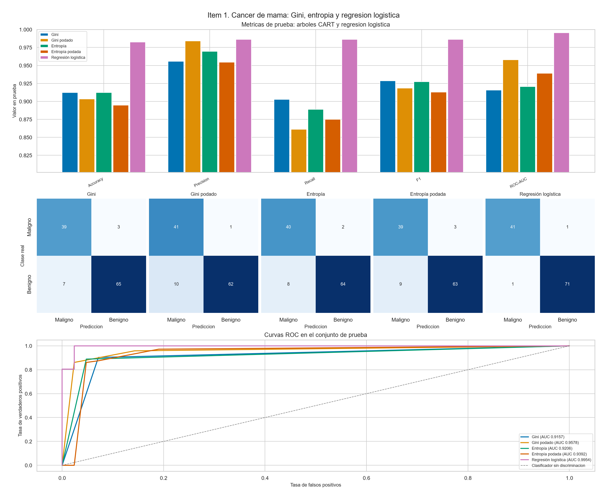
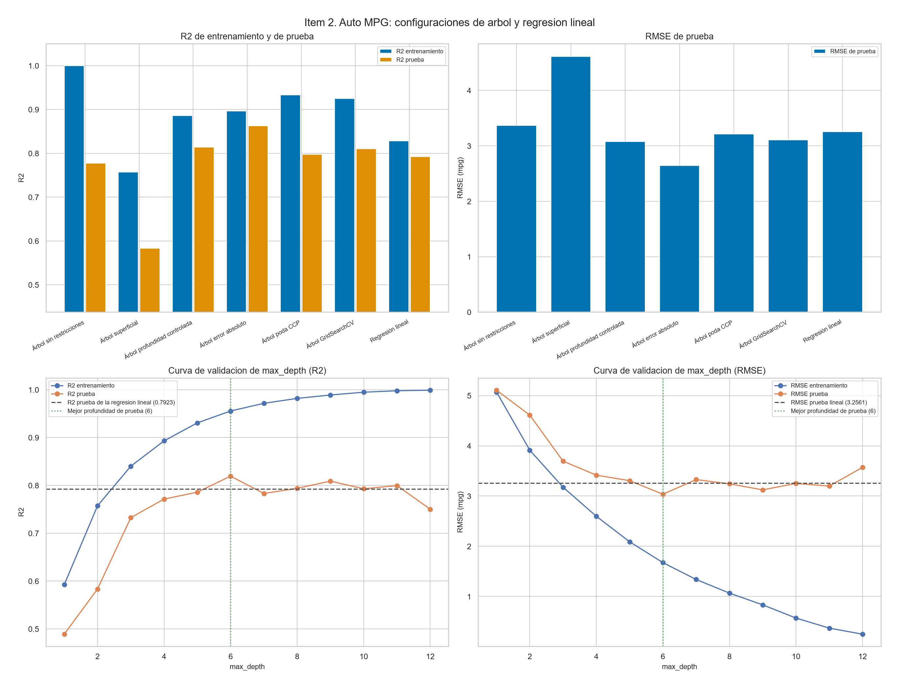
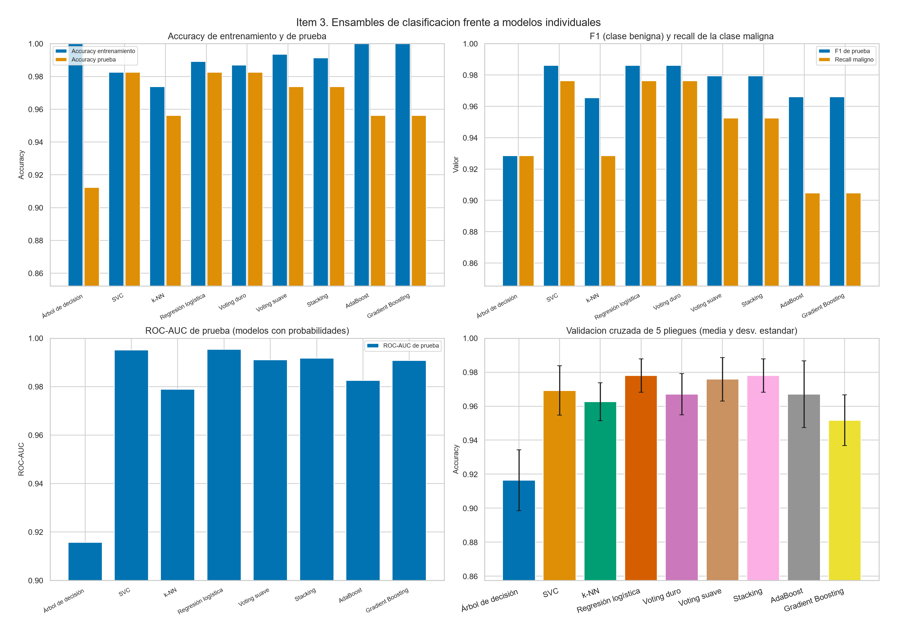
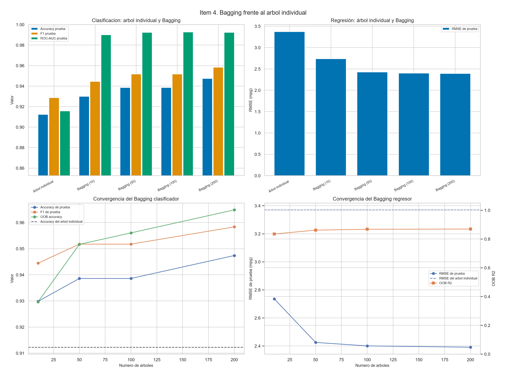
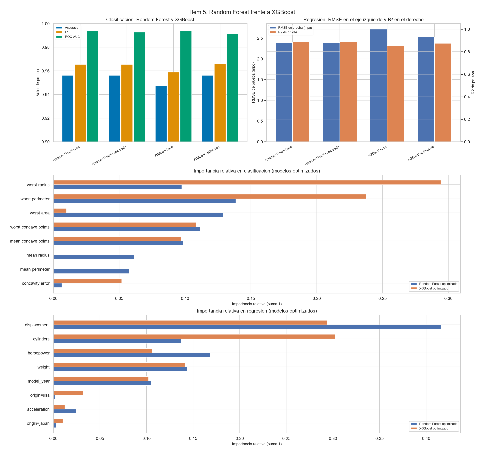

# Tarea de Ejecución 03: Aplicación y Evaluación Empírica de Modelos CART y Ensamblados

| Campo | Contenido |
| --- | --- |
| Código por pregunta | `src/codigo_entrenamiento_p1.py` a `src/codigo_entrenamiento_p5.py` |
| Corrida completa | `src/run_experiments.py` |
| Representación en cuaderno | `representacion_en_ipynb.ipynb` |
| Métricas | `results_metrics.json` |
| Representación en Markdown | [representacion_en_markdown.md](representacion_en_markdown.md) |
| Semilla | 42 |
| Partición | 80% entrenamiento / 20% prueba. En clasificación, estratificada. |
| Validación | 5 pliegues sobre el entrenamiento. Se reporta media ± desviación estándar. |
| Entorno | Python 3.12.10, scikit-learn 1.9.0, XGBoost 3.4.1 |
| Datos | breast_cancer: 569 filas y 30 variables. auto_mpg: 392 filas tras eliminar 6 ausencias de horsepower. |

## Cuadro de dictámenes

Resumen de las cinco respuestas. El desarrollo de cada fila está en la sección enlazada.

| Pregunta | Indicación | Respuesta | Evidencia principal |
| --- | --- | --- | --- |
| [1](#pregunta-1) | Gini y entropía frente a regresión logística | Regresión logística | ROC-AUC de prueba 0.9954 |
| [2](#pregunta-2) | Árboles de regresión frente a regresión lineal | Árbol error absoluto | RMSE de prueba 2.6448 mpg |
| [3](#pregunta-3) | Ensamble clasificador frente a modelo individual | Regresión logística | ROC-AUC de prueba 0.9954 |
| [4](#pregunta-4) | Bagging frente al modelo individual | Bagging (200) | Accuracy 0.9474; RMSE 2.3911 mpg |
| [5](#pregunta-5) | Random Forest frente a XGBoost | Random Forest base; Random Forest optimizado | ROC-AUC 0.9937; RMSE 2.3960 mpg |

Criterio de decisión, igual en las cinco preguntas. En clasificación gana el mayor ROC-AUC de prueba; el desempate usa F1, accuracy de prueba y accuracy media de validación cruzada. En regresión gana el menor RMSE de prueba; el desempate usa el R² de prueba y el R² medio de validación cruzada. Precisión, recall y F1 toman como clase positiva la etiqueta benigna.

<a id="pregunta-1"></a>

## Pregunta 1. Árboles de decisión: Gini, entropía y regresión logística

### Indicación

> Entrene modelos de árboles de decisión con criterios de impureza diferentes (índice gini y entropía) usando el dataset “breast_cancer” de scikit-learn, compare su eficiencia con respecto a un modelo lineal como el Regresor Logístico. ¿Cuál es mejor?

### Respuesta Fundamentada: ¿Cuál es mejor?

**Respuesta: es mejor Regresión logística.**

Entre los árboles sin poda, Entropía obtiene ROC-AUC de prueba 0.9206, F1 0.9275, profundidad 6 y 16 hojas. Gini obtiene ROC-AUC 0.9157, F1 0.9286, profundidad 7 y 19 hojas. Los dos alcanzan accuracy de entrenamiento 1.0000.

La poda reduce esa memorización. Gini podado queda en profundidad 2, 3 hojas y ROC-AUC 0.9578. Entropía podada queda en profundidad 3, 5 hojas y ROC-AUC 0.9392.

Regresión logística alcanza ROC-AUC de prueba 0.9954, F1 0.9861, accuracy de prueba 0.9825 y validación cruzada 0.9780 ± 0.0098. Comete 2 errores en 114 casos de prueba. El recall de la clase maligna es 0.9762. La diferencia de ROC-AUC frente a Gini podado es 3.75 puntos. En 30 variables citológicas, la frontera lineal con penalización L2 separa las clases con menos varianza que los cortes ortogonales de un árbol CART individual.

### Métricas

| Modelo | Acc. train | Acc. test | Precisión | Recall | F1 | ROC-AUC | Recall maligno | CV accuracy (media ± desv.) | Profundidad | Hojas | Tiempo (ms) |
| --- | --- | --- | --- | --- | --- | --- | --- | --- | --- | --- | --- |
| Gini | 1.0000 | 0.9123 | 0.9559 | 0.9028 | 0.9286 | 0.9157 | 0.9286 | 0.9165 ± 0.0179 | 7 | 19 | 11.51 |
| Gini podado | 0.9473 | 0.9035 | 0.9841 | 0.8611 | 0.9185 | 0.9578 | 0.9762 | 0.9297 ± 0.0215 | 2 | 3 | 11.82 |
| Entropía | 1.0000 | 0.9123 | 0.9697 | 0.8889 | 0.9275 | 0.9206 | 0.9524 | 0.9297 ± 0.0237 | 6 | 16 | 13.83 |
| Entropía podada | 0.9604 | 0.8947 | 0.9545 | 0.8750 | 0.9130 | 0.9392 | 0.9286 | 0.9275 ± 0.0164 | 3 | 5 | 7.36 |
| Regresión logística | 0.9890 | 0.9825 | 0.9861 | 0.9861 | 0.9861 | 0.9954 | 0.9762 | 0.9780 ± 0.0098 | no aplica | no aplica | 12.91 |

### Gráfico



### Código correspondiente

Entrenamiento en `src/codigo_entrenamiento_p1.py`. Modelos: `DecisionTreeClassifier(criterion='gini')`, `DecisionTreeClassifier(criterion='entropy')`, sus versiones con `ccp_alpha` elegido por validación cruzada, y `Pipeline` de `StandardScaler` con `LogisticRegression`.

<a id="pregunta-2"></a>

## Pregunta 2. Árboles de regresión con varias configuraciones y regresión lineal

### Indicación

> Entrene modelos de árboles de decisión con varias configuraciones de hiper parámetros usando el dataset auto_mpg, comparar su eficiencia con respecto a un modelo lineal como el Regresor Lineal. ¿Cuál es el mejor?

### Respuesta Fundamentada: ¿Cuál es mejor?

**Respuesta: el mejor es Árbol error absoluto.**

El árbol sin restricciones muestra el sobreajuste: R² de entrenamiento 1.0000, R² de prueba 0.7775 y RMSE de prueba 3.3700 mpg, con profundidad 16 y 263 hojas. La regresión lineal obtiene R² de prueba 0.7923 y RMSE 3.2561 mpg. El árbol superficial, de profundidad 2, queda en RMSE 4.6114 mpg.

La curva de `max_depth` marca el menor RMSE de prueba en profundidad 6 (RMSE 3.0364, R² 0.8194). Árbol error absoluto obtiene RMSE de prueba 2.6448 mpg, R² de prueba 0.8629, MAE 2.0905 y validación cruzada de R² 0.8060 ± 0.0417. Su RMSE es 0.6113 mpg menor que el de la regresión lineal. La validación cruzada de R² favorece a Árbol GridSearchCV (0.8296 ± 0.0408). El dictamen de la pregunta usa el RMSE de prueba.

El árbol regularizado parte el espacio de peso, potencia, cilindrada y año en regiones con distinta pendiente de consumo. Esa interacción queda fuera de un único hiperplano lineal.

### Métricas

| Modelo | R² train | R² test | RMSE test | MAE test | MSE test | CV R² (media ± desv.) | CV RMSE (media ± desv.) | Profundidad | Hojas | Tiempo (ms) |
| --- | --- | --- | --- | --- | --- | --- | --- | --- | --- | --- |
| Árbol sin restricciones | 1.0000 | 0.7775 | 3.3700 | 2.2962 | 11.3567 | 0.7656 ± 0.0975 | 3.6871 ± 0.5824 | 16 | 263 | 10.86 |
| Árbol superficial | 0.7573 | 0.5834 | 4.6114 | 3.4993 | 21.2654 | 0.7153 ± 0.0699 | 4.1464 ± 0.2577 | 2 | 4 | 9.36 |
| Árbol profundidad controlada | 0.8859 | 0.8145 | 3.0772 | 2.2782 | 9.4690 | 0.8036 ± 0.0550 | 3.4382 ± 0.2963 | 4 | 15 | 8.07 |
| Árbol error absoluto | 0.8966 | 0.8629 | 2.6448 | 2.0905 | 6.9952 | 0.8060 ± 0.0417 | 3.4442 ± 0.3331 | 5 | 29 | 13.39 |
| Árbol poda CCP | 0.9336 | 0.7977 | 3.2131 | 2.2556 | 10.3238 | 0.7947 ± 0.0655 | 3.4987 ± 0.2658 | 7 | 23 | 11.04 |
| Árbol GridSearchCV | 0.9254 | 0.8107 | 3.1086 | 2.0481 | 9.6632 | 0.8296 ± 0.0408 | 3.2216 ± 0.3100 | 8 | 53 | 9.78 |
| Regresión lineal | 0.8287 | 0.7923 | 3.2561 | 2.4620 | 10.6023 | 0.8188 ± 0.0143 | 3.3671 ± 0.4179 | no aplica | no aplica | 13.28 |

### Gráfico



### Código correspondiente

Entrenamiento en `src/codigo_entrenamiento_p2.py`. Seis configuraciones de `DecisionTreeRegressor` (sin restricciones, profundidad 2, profundidad controlada, error absoluto, poda por complejidad de costo y `GridSearchCV`) frente a `Pipeline` de `StandardScaler` con `LinearRegression`.

<a id="pregunta-3"></a>

## Pregunta 3. Ensamble clasificador frente a modelo individual

### Indicación

> Entrene un modelo ensemble clasificador, y compare su eficiencia con respecto a un modelo individual. ¿Cuál es mejor?

### Respuesta Fundamentada: ¿Cuál es mejor?

**Respuesta: es mejor Regresión logística.**

El mejor ensamble es Stacking, con ROC-AUC de prueba 0.9917, F1 0.9793 y accuracy 0.9737. El árbol individual queda en ROC-AUC 0.9157, F1 0.9286 y accuracy 0.9123, con accuracy de entrenamiento 1.0000. El ensamble lo supera por 0.0761 de ROC-AUC y por 6.14 puntos porcentuales de accuracy.

El mejor modelo individual es Regresión logística, con ROC-AUC 0.9954, F1 0.9861, accuracy 0.9825 y validación cruzada 0.9780 ± 0.0098. La diferencia de ROC-AUC entre Regresión logística y SVC es 0.03 puntos. El margen de ROC-AUC es ajustado: la diferencia es menor que 0.005 y conviene leerla junto al F1, la accuracy y el tiempo de ajuste. La votación, el apilamiento y el boosting corrigen la varianza del árbol. En este conjunto, la frontera lineal regularizada sigue por encima de esas combinaciones.

### Métricas

| Modelo | Acc. train | Acc. test | Precisión | Recall | F1 | ROC-AUC | Recall maligno | CV accuracy (media ± desv.) | Profundidad | Hojas | Tiempo (ms) |
| --- | --- | --- | --- | --- | --- | --- | --- | --- | --- | --- | --- |
| Árbol de decisión | 1.0000 | 0.9123 | 0.9559 | 0.9028 | 0.9286 | 0.9157 | 0.9286 | 0.9165 ± 0.0179 | 7 | 19 | 13.11 |
| SVC | 0.9824 | 0.9825 | 0.9861 | 0.9861 | 0.9861 | 0.9950 | 0.9762 | 0.9692 ± 0.0146 | no aplica | no aplica | 37.25 |
| k-NN | 0.9736 | 0.9561 | 0.9589 | 0.9722 | 0.9655 | 0.9788 | 0.9286 | 0.9626 ± 0.0112 | no aplica | no aplica | 6.09 |
| Regresión logística | 0.9890 | 0.9825 | 0.9861 | 0.9861 | 0.9861 | 0.9954 | 0.9762 | 0.9780 ± 0.0098 | no aplica | no aplica | 12.53 |
| Voting duro | 0.9868 | 0.9825 | 0.9861 | 0.9861 | 0.9861 | no aplica | 0.9762 | 0.9670 ± 0.0120 | no aplica | no aplica | 66.50 |
| Voting suave | 0.9934 | 0.9737 | 0.9726 | 0.9861 | 0.9793 | 0.9911 | 0.9524 | 0.9758 ± 0.0128 | no aplica | no aplica | 74.44 |
| Stacking | 0.9912 | 0.9737 | 0.9726 | 0.9861 | 0.9793 | 0.9917 | 0.9524 | 0.9780 ± 0.0098 | no aplica | no aplica | 507.46 |
| AdaBoost | 1.0000 | 0.9561 | 0.9467 | 0.9861 | 0.9660 | 0.9825 | 0.9048 | 0.9670 ± 0.0197 | no aplica | no aplica | 253.39 |
| Gradient Boosting | 1.0000 | 0.9561 | 0.9467 | 0.9861 | 0.9660 | 0.9907 | 0.9048 | 0.9516 ± 0.0149 | no aplica | no aplica | 634.48 |

### Gráfico



### Código correspondiente

Entrenamiento en `src/codigo_entrenamiento_p3.py`. Individuales: árbol, SVC con probabilidades, k-NN y regresión logística. Ensambles: `VotingClassifier` duro y suave, `StackingClassifier`, `AdaBoostClassifier` y `GradientBoostingClassifier`.

<a id="pregunta-4"></a>

## Pregunta 4. Bagging clasificador y regresor frente al modelo individual

### Indicación

> Entrene un modelo bagging regresor o clasificador  y compare su eficiencia con respecto a un modelo individual. ¿Cuál es el mejor?

### Respuesta Fundamentada: ¿Cuál es mejor?

**Respuesta: el mejor es el bagging, Bagging (200), en clasificación y en regresión.**

En cáncer de mama, el árbol individual tiene accuracy de prueba 0.9123, F1 0.9286 y ROC-AUC 0.9157. Bagging (200) sube la accuracy a 0.9474 (3.51 puntos porcentuales), el F1 a 0.9583 y el ROC-AUC a 0.9924. Su OOB accuracy es 0.9648 y su validación cruzada es 0.9516 ± 0.0215. El bagging de 100 árboles queda en accuracy 0.9386 y OOB 0.9560.

En auto_mpg, el árbol individual pasa de R² de entrenamiento 1.0000 a R² de prueba 0.7775, con RMSE 3.3700 mpg. Bagging (200) obtiene R² de prueba 0.8880, RMSE 2.3911 mpg, MAE 1.6713 y OOB R² 0.8692. La reducción de RMSE frente al árbol es 0.9789 mpg (29.05%). El bagging de 100 árboles queda en RMSE 2.4004 y OOB R² 0.8676.

El muestreo bootstrap con reemplazo y el promedio de árboles profundos reducen la varianza del predictor. Con correlación ρ entre miembros, la varianza del promedio es ρσ² + (1 − ρ)σ² / B. Si los árboles fueran independientes, ρ = 0 y la varianza quedaría en σ² / B. La correlación estimada en la representación en Markdown muestra que los miembros comparten errores, y aun así el bagging mejora la prueba en las dos tareas.

### Métricas

Clasificación en cáncer de mama:

| Modelo | Acc. train | Acc. test | Precisión | Recall | F1 | ROC-AUC | Recall maligno | CV accuracy (media ± desv.) | Profundidad | Hojas | Tiempo (ms) | OOB accuracy |
| --- | --- | --- | --- | --- | --- | --- | --- | --- | --- | --- | --- | --- |
| Árbol individual | 1.0000 | 0.9123 | 0.9559 | 0.9028 | 0.9286 | 0.9157 | 0.9286 | 0.9165 ± 0.0179 | 7 | 19 | 12.01 | no aplica |
| Bagging (10) | 0.9956 | 0.9298 | 0.9444 | 0.9444 | 0.9444 | 0.9899 | 0.9048 | 0.9495 ± 0.0112 | no aplica | no aplica | 90.64 | 0.9297 |
| Bagging (50) | 1.0000 | 0.9386 | 0.9452 | 0.9583 | 0.9517 | 0.9922 | 0.9048 | 0.9516 ± 0.0204 | no aplica | no aplica | 552.93 | 0.9516 |
| Bagging (100) | 1.0000 | 0.9386 | 0.9452 | 0.9583 | 0.9517 | 0.9927 | 0.9048 | 0.9516 ± 0.0192 | no aplica | no aplica | 894.52 | 0.9560 |
| Bagging (200) | 1.0000 | 0.9474 | 0.9583 | 0.9583 | 0.9583 | 0.9924 | 0.9286 | 0.9516 ± 0.0215 | no aplica | no aplica | 1805.80 | 0.9648 |

Regresión en auto_mpg:

| Modelo | R² train | R² test | RMSE test | MAE test | MSE test | CV R² (media ± desv.) | CV RMSE (media ± desv.) | Profundidad | Hojas | Tiempo (ms) | OOB R² |
| --- | --- | --- | --- | --- | --- | --- | --- | --- | --- | --- | --- |
| Árbol individual | 1.0000 | 0.7775 | 3.3700 | 2.2962 | 11.3567 | 0.7656 ± 0.0975 | 3.6871 ± 0.5824 | 16 | 263 | 12.66 | no aplica |
| Bagging (10) | 0.9710 | 0.8534 | 2.7358 | 1.9773 | 7.4845 | 0.8592 ± 0.0309 | 2.9265 ± 0.1796 | no aplica | no aplica | 57.30 | 0.8349 |
| Bagging (50) | 0.9795 | 0.8848 | 2.4252 | 1.7292 | 5.8814 | 0.8684 ± 0.0305 | 2.8336 ± 0.2845 | no aplica | no aplica | 236.20 | 0.8615 |
| Bagging (100) | 0.9809 | 0.8871 | 2.4004 | 1.7112 | 5.7617 | 0.8653 ± 0.0326 | 2.8649 ± 0.2940 | no aplica | no aplica | 453.20 | 0.8676 |
| Bagging (200) | 0.9821 | 0.8880 | 2.3911 | 1.6713 | 5.7172 | 0.8636 ± 0.0324 | 2.8839 ± 0.2961 | no aplica | no aplica | 986.01 | 0.8692 |

### Gráfico



### Código correspondiente

Entrenamiento en `src/codigo_entrenamiento_p4.py`. `BaggingClassifier` y `BaggingRegressor` con 10, 50, 100 y 200 árboles, `bootstrap=True` y `oob_score=True`, frente al árbol individual de cada tarea.

<a id="pregunta-5"></a>

## Pregunta 5. Random Forest frente a XGBoost

### Indicación

> Entrene un modelo RandomForest y compare su eficiencia con respecto a un modelo XGBoost. ¿Cuál es mejor?

### Respuesta Fundamentada: ¿Cuál es mejor?

**Respuesta: en clasificación es mejor Random Forest base. En regresión es mejor Random Forest optimizado.**

Random Forest promedia árboles profundos en paralelo. En clasificación cada árbol ve un subconjunto de variables de tamaño cercano a la raíz cuadrada de p, lo que descorrelaciona los árboles y reduce la varianza. XGBoost suma árboles en serie con una aproximación de Taylor de segundo orden y regularización L2 sobre las hojas.

En clasificación, Random Forest base obtiene ROC-AUC de prueba 0.9937, F1 0.9655, accuracy 0.9561 y validación cruzada 0.9626 ± 0.0179. XGBoost base queda en ROC-AUC 0.9937, F1 0.9589 y accuracy 0.9474 (diferencia de 0.00 puntos de ROC-AUC). El ROC-AUC de prueba empata en la práctica, así que el desempate lo resuelven el F1 y la accuracy. El mejor XGBoost de esta tarea, XGBoost base, alcanza ROC-AUC 0.9937 y F1 0.9589. La validación cruzada de ROC-AUC favorece a XGBoost optimizado.

En regresión, Random Forest optimizado obtiene RMSE de prueba 2.3960 mpg, R² 0.8875, MAE 1.7061 y validación cruzada de R² 0.8667 ± 0.0304. Random Forest base tiene RMSE 2.3966. El margen de RMSE es ajustado: la diferencia relativa es 0.02%, por debajo del 1%. El mejor XGBoost de regresión, XGBoost optimizado, queda en RMSE 2.5265 mpg y R² 0.8749. La validación cruzada de R² favorece a XGBoost optimizado.

### Métricas

Clasificación en cáncer de mama:

| Modelo | Acc. train | Acc. test | Precisión | Recall | F1 | ROC-AUC | Recall maligno | CV accuracy (media ± desv.) | Profundidad | Hojas | Tiempo (ms) |
| --- | --- | --- | --- | --- | --- | --- | --- | --- | --- | --- | --- |
| Random Forest base | 1.0000 | 0.9561 | 0.9589 | 0.9722 | 0.9655 | 0.9937 | 0.9286 | 0.9626 ± 0.0179 | no aplica | no aplica | 361.36 |
| Random Forest optimizado | 0.9934 | 0.9561 | 0.9589 | 0.9722 | 0.9655 | 0.9927 | 0.9286 | 0.9560 ± 0.0120 | no aplica | no aplica | 866.65 |
| XGBoost base | 1.0000 | 0.9474 | 0.9459 | 0.9722 | 0.9589 | 0.9937 | 0.9048 | 0.9648 ± 0.0162 | no aplica | no aplica | 1997.92 |
| XGBoost optimizado | 1.0000 | 0.9561 | 0.9467 | 0.9861 | 0.9660 | 0.9914 | 0.9048 | 0.9736 ± 0.0226 | no aplica | no aplica | 176.28 |

Regresión en auto_mpg:

| Modelo | R² train | R² test | RMSE test | MAE test | MSE test | CV R² (media ± desv.) | CV RMSE (media ± desv.) | Profundidad | Hojas | Tiempo (ms) |
| --- | --- | --- | --- | --- | --- | --- | --- | --- | --- | --- |
| Random Forest base | 0.9809 | 0.8875 | 2.3966 | 1.7064 | 5.7435 | 0.8667 ± 0.0305 | 2.8535 ± 0.2911 | no aplica | no aplica | 407.54 |
| Random Forest optimizado | 0.9809 | 0.8875 | 2.3960 | 1.7061 | 5.7409 | 0.8667 ± 0.0304 | 2.8534 ± 0.2907 | no aplica | no aplica | 109.46 |
| XGBoost base | 0.9987 | 0.8556 | 2.7145 | 1.8818 | 7.3683 | 0.8370 ± 0.0445 | 3.1265 ± 0.1852 | no aplica | no aplica | 41.88 |
| XGBoost optimizado | 0.9361 | 0.8749 | 2.5265 | 1.8821 | 6.3831 | 0.8671 ± 0.0373 | 2.8296 ± 0.2216 | no aplica | no aplica | 17.55 |

### Gráfico



### Código correspondiente

Entrenamiento en `src/codigo_entrenamiento_p5.py`. `RandomForestClassifier`, `RandomForestRegressor`, `XGBClassifier` y `XGBRegressor`, cada uno en versión base y en versión elegida por `GridSearchCV`.

## Conclusiones

Las cinco indicaciones quedan respondidas con la métrica de prueba y el mismo protocolo de partición y validación cruzada.

| Pregunta | Conclusión |
| --- | --- |
| 1 | Es mejor Regresión logística: ROC-AUC de prueba 0.9954. Entre los árboles sin poda, Entropía generaliza con menos hojas. Los dos árboles sin poda llegan a accuracy de entrenamiento 1.0000. |
| 2 | El mejor es Árbol error absoluto: RMSE de prueba 2.6448 mpg y R² 0.8629. El árbol sin restricciones cae de R² 1.0000 en entrenamiento a 0.7775 en prueba. Su RMSE de prueba, 3.3700 mpg, es mayor que el de la regresión lineal, 3.2561 mpg. |
| 3 | Es mejor Regresión logística, con ROC-AUC 0.9954. Stacking supera al árbol individual (ROC-AUC 0.9157) y alcanza 0.9917. |
| 4 | El mejor es el bagging: Bagging (200) en clasificación (accuracy 0.9474) y Bagging (200) en regresión (RMSE 2.3911 mpg). |
| 5 | En clasificación es mejor Random Forest base (ROC-AUC 0.9937, F1 0.9655). En regresión es mejor Random Forest optimizado (RMSE 2.3960 mpg). |

Un árbol CART sin restricciones ajusta el entrenamiento hasta dejar poca o ninguna impureza, y esa exactitud se reduce en la prueba. La regresión con penalización L2, la poda, el bagging y el boosting atacan esa varianza por caminos distintos. En cáncer de mama la señal es fuerte y varios modelos superan 0.95 de ROC-AUC. En auto_mpg hay una parte lineal grande y una parte de interacción que aparece cuando el árbol o el ensamble están regularizados. El detalle de cada contraste, con pruebas t, matrices de confusión, coeficientes e importancias, está en [representacion_en_markdown.md](representacion_en_markdown.md).

### Limitaciones

- La prueba de cáncer de mama tiene 114 casos y la de auto_mpg tiene 79. Unos pocos casos mueven la tercera cifra decimal.
- La validación cruzada de un modelo elegido por búsqueda usa los mismos pliegues de la búsqueda, así que esa media puede ser optimista. La prueba no entra en la selección.
- Con cinco pliegues, la prueba t de la representación en Markdown tiene poca potencia. El dictamen usa la métrica de prueba.
- Las importancias comparan la contribución interna de cada algoritmo. No son efectos causales.

## Ubicación del material

| Requisito de la indicación | Dónde se evidencia |
| --- | --- |
| Respuesta a cada pregunta | Secciones Pregunta 1 a Pregunta 5 de este README |
| Resumen de hallazgos | Cuadro de dictámenes y sección de conclusiones |
| Métricas de entrenamiento, prueba y validación cruzada | Tabla de cada pregunta y `results_metrics.json` |
| Gráficos comparativos | Carpeta `plots/` e imágenes incrustadas bajo cada pregunta |
| Código de los modelos entrenados | `src/codigo_entrenamiento_p1.py` a `src/codigo_entrenamiento_p5.py` y `src/run_experiments.py` |
| Detalle de datos, pruebas e hiperparámetros | [representacion_en_markdown.md](representacion_en_markdown.md) |

Los modelos de cada pregunta están en `src/codigo_entrenamiento_p1.py` a `src/codigo_entrenamiento_p5.py`. La corrida completa está en `src/run_experiments.py`. La tarea también está representada en `representacion_en_ipynb.ipynb` y en [representacion_en_markdown.md](representacion_en_markdown.md).

| Pregunta | Función | Datos | Figura |
| --- | --- | --- | --- |
| 1 | `src/codigo_entrenamiento_p1.py` | `load_breast_cancer` | `plots/item1_breast_cancer.png` |
| 2 | `src/codigo_entrenamiento_p2.py` | auto_mpg limpio, 392 filas | `plots/item2_auto_mpg.png` |
| 3 | `src/codigo_entrenamiento_p3.py` | `load_breast_cancer` | `plots/item3_ensemble_clf.png` |
| 4 | `src/codigo_entrenamiento_p4.py` | breast_cancer y auto_mpg | `plots/item4_bagging.png` |
| 5 | `src/codigo_entrenamiento_p5.py` | breast_cancer y auto_mpg | `plots/item5_rf_vs_xgboost.png` |

Para regenerar métricas, figuras, este README y la representación en Markdown:

```powershell

git clone https://github.com/paololuna-luw/cart-and-ensemble-benchmarks.git

cd cart-and-ensemble-benchmarks

python -m pip install -r requirements.txt

python src/run_experiments.py

```

Para entrenar una sola pregunta, desde la raíz del repositorio:

```powershell

python src/codigo_entrenamiento_p1.py

python src/codigo_entrenamiento_p2.py

python src/codigo_entrenamiento_p3.py

python src/codigo_entrenamiento_p4.py

python src/codigo_entrenamiento_p5.py

```

Experimento de referencia iniciado el 2026-10-20 15:59:47. Duración de los ajustes, sin el notebook: 236.86 s.
